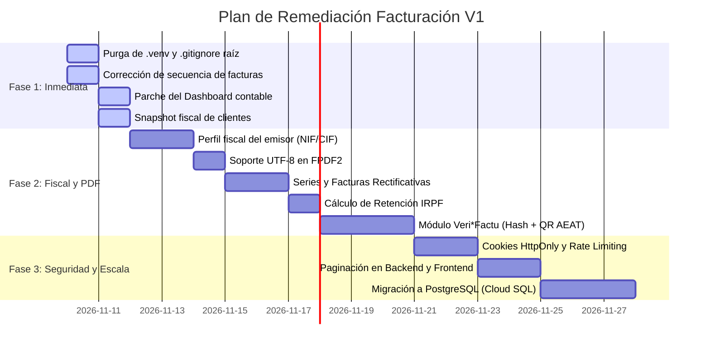

# Auditoría Técnica Exhaustiva de Fallos y Vulnerabilidades
**Aplicación:** Facturacion-V1  
**Repositorio:** [https://github.com/perendo/Facturacion-V1.git](https://github.com/perendo/Facturacion-V1.git)  
**Commit auditado:** `294db08`  
**Fecha de auditoría:** 9 de noviembre de 2026  
**Calificación Global:** 54 / 100 — Riesgo Alto (Requiere remediación antes de pase a producción)

---

## Índice de Contenidos

1. [Resumen Ejecutivo de Fallos por Severidad](#1-resumen-ejecutivo-de-fallos-por-severidad)
2. [Matriz General de Fallos](#2-matriz-general-de-fallos)
3. [Bloque 1: Fallos Críticos (Nivel Bloqueante)](#3-bloque-1-fallos-críticos-nivel-bloqueante)
   - [F-001: Subida accidental de `.venv` con 6.000+ archivos y binarios en Git](#f-001-subida-accidental-de-venv-con-6000-archivos-y-binarios-en-git)
   - [F-002: Fuga de datos y desajuste de correlatividad en secuencia de facturas multi-inquilino](#f-002-fuga-de-datos-y-desajuste-de-correlatividad-en-secuencia-de-facturas-multi-inquilino)
   - [F-003: Incumplimiento de la Ley Antifraude 11/2021 y RD 1007/2023 (Veri*Factu)](#f-003-incumplimiento-de-la-ley-antifraude-112021-y-rd-10072023-verifactu)
   - [F-004: Inexistencia de datos fiscales del emisor (Facturas nulas según RD 1619/2012)](#f-004-inexistencia-de-datos-fiscales-del-emisor-facturas-nulas-según-rd-16192012)
4. [Bloque 2: Fallos de Severidad Alta](#4-bloque-2-fallos-de-severidad-alta)
   - [F-005: Bug contable en Dashboard (Suma de facturas canceladas a ingresos)](#f-005-bug-contable-en-dashboard-suma-de-facturas-canceladas-a-ingresos)
   - [F-006: Pérdida irreversible de datos fiscales por borrado en cascada (`ON DELETE SET NULL`)](#f-006-pérdida-irreversible-de-datos-fiscales-por-borrado-en-cascada-on-delete-set-null)
   - [F-007: Almacenamiento inseguro de JWT en Cookies no-HttpOnly y LocalStorage](#f-007-almacenamiento-inseguro-de-jwt-en-cookies-no-httponly-y-localstorage)
   - [F-008: Crasheo en generación de PDF por falta de soporte UTF-8 en FPDF](#f-008-crasheo-en-generación-de-pdf-por-falta-de-soporte-utf-8-en-fpdf)
   - [F-009: Inexistencia de Facturas Rectificativas (Abonos) y retención de IRPF](#f-009-inexistencia-de-facturas-rectificativas-abonos-y-retención-de-irpf)
5. [Bloque 3: Fallos de Severidad Media](#5-bloque-3-fallos-de-severidad-media)
   - [F-010: Descuadre entre descuento global y líneas individuales en desglose de IVA](#f-010-descuadre-entre-descuento-global-y-líneas-individuales-en-desglose-de-iva)
   - [F-011: Ausencia de paginación en endpoints de facturas, clientes y productos](#f-011-ausencia-de-paginación-en-endpoints-de-facturas-clientes-y-productos)
   - [F-012: Bloqueo de concurrencia en SQLite sin modo WAL](#f-012-bloqueo-de-concurrencia-en-sqlite-sin-modo-wal)
   - [F-013: Falta de Rate Limiting y política débil de contraseñas](#f-013-falta-de-rate-limiting-y-política-débil-de-contraseñas)
   - [F-014: Inyección de usuario demo con contraseña fija en cada inicio de servidor](#f-014-inyección-de-usuario-demo-con-contraseña-fija-en-cada-inicio-de-servidor)
   - [F-015: Dependencias muertas en frontend y desaprovechamiento de Zod](#f-015-dependencias-muertas-en-frontend-y-desaprovechamiento-de-zod)
6. [Bloque 4: Fallos de Severidad Baja y Calidad de Código](#6-bloque-4-fallos-de-severidad-baja-y-calidad-de-código)
   - [F-016: Uso de `window.confirm` bloqueante y propenso a fallar en iframes](#f-016-uso-de-windowconfirm-bloqueante-y-propenso-a-fallar-en-iframes)
   - [F-017: Inconsistencia visual del modo oscuro (Dark Mode roto)](#f-017-inconsistencia-visual-del-modo-oscuro-dark-mode-roto)
   - [F-018: Commit monolítico único en Git sin historial semántico](#f-018-commit-monolítico-único-en-git-sin-historial-semántico)
7. [Plan de Acción y Matriz de Remediación](#7-plan-de-acción-y-matriz-de-remediación)

---

## 1. Resumen Ejecutivo de Fallos por Severidad

| Severidad | Total Hallazgos | Bloqueo Producción | Tiempo Estimado de Resolución |
| :--- | :---: | :---: | :---: |
| 🔴 **Crítica** | 4 | **SÍ (Inmediato)** | 2 - 3 días |
| 🟠 **Alta** | 5 | **SÍ (Antes de clientes reales)** | 3 - 5 días |
| 🟡 **Media** | 6 | No (Riesgo operativo y de escala) | 3 - 4 días |
| 🔵 **Baja / Calidad** | 3 | No (Deuda técnica y UX) | 1 - 2 días |
| **TOTAL** | **18 fallos** | — | **~2 semanas de sprint** |

---

## 2. Matriz General de Fallos

| ID | Título del Fallo | Módulo Afectado | Severidad | Categoría |
| :--- | :--- | :--- | :---: | :--- |
| **F-001** | Subida accidental de `.venv` (6.000+ archivos) | Raíz del Repositorio | 🔴 Crítica | DevOps / Git |
| **F-002** | Fuga de datos y desajuste en secuencia de facturas | `backend/services/invoice_service.py` | 🔴 Crítica | Arquitectura / BD |
| **F-003** | Incumplimiento de Ley 11/2021 y RD 1007/2023 (Veri*Factu) | `backend/models/invoice.py` | 🔴 Crítica | Normativa Fiscal |
| **F-004** | Datos fiscales del emisor inexistentes (facturas nulas) | `backend/models/user.py` / `pdf_service.py` | 🔴 Crítica | Normativa Fiscal |
| **F-005** | Dashboard suma facturas canceladas como ingresos | `backend/services/dashboard_service.py` | 🟠 Alta | Lógica Contable |
| **F-006** | Pérdida de datos fiscales al borrar clientes (`SET NULL`) | `backend/models/invoice.py` | 🟠 Alta | Integridad de Datos |
| **F-007** | JWT expuesto en cookies no-HttpOnly y LocalStorage | `frontend/lib/auth.ts` | 🟠 Alta | Seguridad |
| **F-008** | Excepción Unicode en PDF por falta de soporte UTF-8 | `backend/services/pdf_service.py` | 🟠 Alta | Backend / PDF |
| **F-009** | Sin soporte de facturas rectificativas ni retención IRPF | `backend/models/invoice.py` | 🟠 Alta | Normativa Fiscal |
| **F-010** | Descuadre de redondeo en descuento global sobre líneas | `backend/services/invoice_service.py` | 🟡 Media | Lógica Contable |
| **F-011** | Listados sin paginación (riesgo de colapso de memoria) | `backend/routers/*.py` | 🟡 Media | Rendimiento / API |
| **F-012** | SQLite sin modo WAL para concurrencia | `backend/database.py` | 🟡 Media | Base de Datos |
| **F-013** | Ausencia de Rate Limiting y contraseñas de 6 caracteres | `backend/routers/auth.py` | 🟡 Media | Seguridad |
| **F-014** | Usuario demo fijo insertado en cada arranque | `backend/main.py` | 🟡 Media | Seguridad |
| **F-015** | Dependencia muerta `axios` y formularios sin Zod | `frontend/package.json` | 🟡 Media | Frontend / Deuda |
| **F-016** | Diálogos destructivos con `window.confirm` | `frontend/app/clients/page.tsx` | 🔵 Baja | Frontend / UX |
| **F-017** | Modo oscuro roto (clases Tailwind no preparadas) | `frontend/components/Navbar.tsx` | 🔵 Baja | Frontend / UI |
| **F-018** | Repositorio con commit único sin trazabilidad de ramas | Historial Git | 🔵 Baja | DevOps / Git |

---

## 3. Bloque 1: Fallos Críticos (Nivel Bloqueante)

### F-001: Subida accidental de `.venv` con 6.000+ archivos y binarios en Git
* **Severidad:** 🔴 Crítica
* **Archivos afectados:** `/.venv/`, `/.gitignore` (inexistente en la raíz)
* **Descripción técnica:**
  En el commit `294db08`, se incluyó la carpeta `.venv` completa con 6.027 archivos y 1.378.185 líneas añadidas. Esto contiene ejecutables binarios de Windows de 64 bits (`.venv/Scripts/python.exe`, `.venv/Scripts/pip3.exe`, `.venv/Scripts/*.exe`), librerías precompiladas de terceros y archivos `.pyc`.
* **Impacto:**
  - El repositorio pesa decenas de megabytes innecesariamente.
  - La clonación en servidores CI/CD o entornos Linux/Docker se ralentiza y puede fallar por permisos o dependencias cruzadas.
  - No existe `.gitignore` en la raíz; cualquier nuevo fichero local (como bases de datos SQLite `billing.db` o ficheros `.env` con secretos reales) terminará comiteado por error.
* **Solución paso a paso:**
  ```bash
  # 1. Eliminar .venv del seguimiento de Git sin borrar los archivos del disco local
  git rm -r --cached .venv

  # 2. Crear el archivo .gitignore en la raíz
  cat << 'EOF' > .gitignore
  # Entornos virtuales Python
  .venv/
  venv/
  ENV/
  env/

  # Ficheros temporales y compilados Python
  __pycache__/
  *.py[cod]
  *$py.class
  *.sqlite3
  *.db

  # Variables de entorno con credenciales
  .env
  .env.local
  .env.*.local

  # Node & Frontend
  node_modules/
  .next/
  dist/
  out/
  build/

  # Archivos generados
  *.pdf
  test_invoice.pdf
  .DS_Store
  Thumbs.db
  EOF

  # 3. Guardar el cambio
  git commit -m "chore: purge .venv from git and create root .gitignore"
  ```

---

### F-002: Fuga de datos y desajuste de correlatividad en secuencia de facturas multi-inquilino
* **Severidad:** 🔴 Crítica
* **Archivos afectados:** `backend/app/services/invoice_service.py`, `backend/app/models/invoice.py`
* **Código vulnerable actual:**
  ```python
  def generate_invoice_number(db: Session, user_id: int, year: Optional[int] = None) -> str:
      prefix = f"INV-{year}-"
      existing = db.query(Invoice).filter(Invoice.user_id == user_id, Invoice.number.like(f"{prefix}%")).count()
      seq = existing + 1
      while True:
          number = f"{prefix}{seq:04d}"
          clash = db.query(Invoice).filter(Invoice.number == number).first() # ¡Consulta global en toda la BD!
          if not clash:
              break
          seq += 1
      return number
  ```
* **Mecanismo del Fallo:**
  En `models/invoice.py`, la columna está definida como:
  `number = Column(String(30), unique=True, nullable=False)` (única en toda la base de datos).
  La variable `existing` cuenta facturas por `user_id`. Si el **Usuario A** ha emitido facturas de `INV-2026-0001` a `INV-2026-0040`, cuando el **Usuario B** se registra y emite su primera factura:
  1. Su cuenta `existing` devuelve `0`.
  2. Su secuencia inicial `seq` es `1`.
  3. Al consultar `clash = db.query(Invoice).filter(Invoice.number == "INV-2026-0001").first()`, encuentra la del Usuario A.
  4. El bucle salta las 40 facturas existentes y le entrega al Usuario B la factura **`INV-2026-0041`**.
* **Impacto:**
  - **Fuga de datos (Information Disclosure):** Cualquier usuario nuevo que emita una factura conoce exactamente el volumen total de facturas emitidas por todos los demás clientes de la plataforma.
  - **Ilegalidad fiscal:** Para el Usuario B, su contabilidad empieza con el número 41, teniendo un vacío fiscal no explicable ante la Agencia Tributaria.
  - **Condición de carrera (Race Condition):** Si dos usuarios emiten facturas en el mismo segundo, ambos calculan el mismo número antes del `db.commit()` y uno de ellos sufrirá un error HTTP 500 por `IntegrityError: UNIQUE constraint failed`.
* **Solución recomendada:**
  1. Modificar el modelo para que la unicidad sea por `(user_id, series, year, sequence_number)`:
  ```python
  # backend/app/models/invoice.py
  from sqlalchemy import UniqueConstraint

  class Invoice(Base):
      __tablename__ = "invoices"
      # ...
      series = Column(String(10), nullable=False, default="INV")
      year = Column(Integer, nullable=False)
      sequence_number = Column(Integer, nullable=False)
      number = Column(String(50), nullable=False, index=True)

      __table_args__ = (
          UniqueConstraint("user_id", "series", "year", "sequence_number", name="uq_user_invoice_sequence"),
      )
  ```
  2. Generar el número atómicamente por usuario:
  ```python
  # backend/app/services/invoice_service.py
  from sqlalchemy import func

  def generate_invoice_number(db: Session, user_id: int, series: str = "INV", year: Optional[int] = None) -> tuple[str, int]:
      year = year or datetime.utcnow().year
      max_seq = (
          db.query(func.max(Invoice.sequence_number))
          .filter(
              Invoice.user_id == user_id,
              Invoice.series == series,
              Invoice.year == year
          )
          .scalar()
      ) or 0
      next_seq = max_seq + 1
      return f"{series}-{year}-{next_seq:04d}", next_seq
  ```

---

### F-003: Incumplimiento de la Ley Antifraude 11/2021 y RD 1007/2023 (Veri*Factu)
* **Severidad:** 🔴 Crítica
* **Archivos afectados:** `backend/app/models/invoice.py`, `backend/app/services/pdf_service.py`
* **Descripción técnica:**
  En España, la normativa de sistemas informáticos de facturación (SIF) exige que todo software garantice la integridad, inalterabilidad, trazabilidad y legibilidad de los registros de facturación.
* **Carencias identificadas:**
  1. **Sin encadenamiento criptográfico:** No se calcula el hash SHA-256 encadenado del registro anterior.
  2. **Sin registro inmutable de eventos:** Las facturas no tienen huella digital de expedición ni anulación.
  3. **Sin código QR de cotejo tributario:** El PDF no genera el código QR estandarizado exigido por la AEAT.
* **Impacto Legal:**
  El artículo 201 bis de la Ley General Tributaria establece **multas de 50.000 € por ejercicio** para el desarrollador que comercialice o distribuya software no conforme, y multas similares para las empresas o autónomos que lo utilicen.
* **Solución:**
  Crear una tabla de registros inalterables y generar el hash encadenado con la fórmula reglamentaria:
  ```python
  import hashlib

  def calculate_verifactu_hash(
      emisor_nif: str,
      numero_factura: str,
      fecha_emision: str,
      total_factura: str,
      prev_hash: str
  ) -> str:
      cadena = f"{emisor_nif}|{numero_factura}|{fecha_emision}|{total_factura}|{prev_hash}"
      return hashlib.sha256(cadena.encode("utf-8")).hexdigest().upper()
  ```

---

### F-004: Inexistencia de datos fiscales del emisor (Facturas nulas según RD 1619/2012)
* **Severidad:** 🔴 Crítica
* **Archivos afectados:** `backend/app/models/user.py`, `backend/app/services/pdf_service.py`
* **Evidencia en código:**
  ```python
  class User(Base):
      id = Column(Integer, primary_key=True)
      email = Column(String(255), unique=True, nullable=False)
      hashed_password = Column(String(255), nullable=False)
      full_name = Column(String(255), nullable=True)
      # No existen: tax_id, tax_address, postal_code, city, country
  ```
  En `pdf_service.py`:
  ```python
  pdf.cell(0, 6, f"{user.full_name or user.email}", ln=True)
  pdf.cell(0, 6, f"{user.email}", ln=True)
  ```
* **Impacto:**
  El **Artículo 6 del Real Decreto 1619/2012** (Reglamento de Facturación) estipula como contenido obligatorio e inexcusable:
  - Número de Identificación Fiscal (NIF/CIF) del emisor.
  - Nombre y apellidos o razón social completa.
  - Domicilio fiscal completo (calle, número, código postal y población).
  Una factura que solo contenga un email y un nombre sin NIF ni domicilio es **jurídicamente inválida**, no deducible y susceptible de rechazo inmediato por parte de los clientes y la Agencia Tributaria.
* **Solución:**
  Añadir campos fiscales al modelo `User` o crear la tabla `CompanyProfile`:
  ```python
  class CompanyProfile(Base):
      __tablename__ = "company_profiles"
      id = Column(Integer, primary_key=True)
      user_id = Column(Integer, ForeignKey("users.id", ondelete="CASCADE"), unique=True, nullable=False)
      legal_name = Column(String(255), nullable=False)
      tax_id = Column(String(20), nullable=False) # NIF / CIF
      tax_address = Column(String(255), nullable=False)
      postal_code = Column(String(10), nullable=False)
      city = Column(String(100), nullable=False)
      province = Column(String(100), nullable=False)
  ```

---

## 4. Bloque 2: Fallos de Severidad Alta

### F-005: Bug contable en Dashboard (Suma de facturas canceladas a ingresos)
* **Severidad:** 🟠 Alta
* **Archivo afectado:** `backend/app/services/dashboard_service.py`
* **Código actual:**
  ```python
  for inv in invoices:
      total = Decimal(str(inv.total or 0))
      total_invoiced += total  # ¡ERROR: Suma status == "cancelled"!
      st = inv.status
      if st == "paid":
          total_paid += total
      elif st in ("sent", "draft"):
          total_pending += total  # ¡ERROR: Borradores no son pendientes de cobro!
  ```
* **Impacto:**
  1. Si un usuario emite una factura errónea por 20.000 € y la anula (`cancelled`), el Dashboard sigue sumando los 20.000 € a la facturación total.
  2. Los borradores (`draft`) son presupuestos o borradores internos de trabajo; computarlos en `total_pending` falsea el estado de tesorería y cuentas por cobrar.
* **Solución:**
  ```python
  # Consulta SQL optimizada en dashboard_service.py:
  from sqlalchemy import func, case

  def get_summary(db: Session, user_id: int) -> dict:
      base = db.query(Invoice).filter(Invoice.user_id == user_id)
      
      # Solo facturas válidas emitidas o cobradas:
      total_invoiced = (
          base.filter(Invoice.status.in_(["sent", "paid"]))
          .with_entities(func.coalesce(func.sum(Invoice.total), 0))
          .scalar()
      )
      total_paid = (
          base.filter(Invoice.status == "paid")
          .with_entities(func.coalesce(func.sum(Invoice.total), 0))
          .scalar()
      )
      total_pending = (
          base.filter(Invoice.status == "sent")
          .with_entities(func.coalesce(func.sum(Invoice.total), 0))
          .scalar()
      )
      return {
          "total_invoiced": Decimal(str(total_invoiced)),
          "total_paid": Decimal(str(total_paid)),
          "total_pending": Decimal(str(total_pending)),
          "count_by_status": dict(base.with_entities(Invoice.status, func.count()).group_by(Invoice.status).all()),
      }
  ```

---

### F-006: Pérdida irreversible de datos fiscales por borrado en cascada (`ON DELETE SET NULL`)
* **Severidad:** 🟠 Alta
* **Archivo afectado:** `backend/app/models/invoice.py`
* **Evidencia en código:**
  ```python
  client_id = Column(Integer, ForeignKey("clients.id", ondelete="SET NULL"), nullable=True, index=True)
  ```
  En `pdf_service.py`:
  ```python
  if client:
      pdf.cell(0, 6, f"{client.name}", ln=True)
  else:
      pdf.cell(0, 6, "Sin cliente asignado", ln=True)
  ```
* **Impacto:** Si una empresa elimina un cliente en el módulo de clientes, todas las facturas históricas emitidas a ese cliente quedan con `client_id = NULL`. Si Hacienda solicita las facturas de hace 2 años para una inspección, el software generará PDFs que rezan *"Sin cliente asignado"*, perdiendo toda validez legal e infringiendo la obligación de conservación de libros oficiales durante 4 años (Ley General Tributaria) y 6 años (Código de Comercio).
* **Solución:** Guardar un snapshot (instantánea inmutable) de los datos del cliente en la factura al emitirla:
  ```python
  # En models/invoice.py
  client_id = Column(Integer, ForeignKey("clients.id", ondelete="RESTRICT"), nullable=True)
  recipient_name = Column(String(255), nullable=False)
  recipient_tax_id = Column(String(50), nullable=True)
  recipient_address = Column(Text, nullable=True)
  ```

---

### F-007: Almacenamiento inseguro de JWT en Cookies no-HttpOnly y LocalStorage
* **Severidad:** 🟠 Alta
* **Archivo afectado:** `frontend/lib/auth.ts`
* **Evidencia en código:**
  ```typescript
  export function setToken(token: string): void {
    if (typeof window === "undefined") return;
    localStorage.setItem(TOKEN_KEY, token);
    setCookie(TOKEN_KEY, token, 1);
  }

  function setCookie(name: string, value: string, days: number): void {
    if (typeof document === "undefined") return;
    const expires = new Date(Date.now() + days * 864e5).toUTCString();
    document.cookie = `${name}=${encodeURIComponent(value)}; expires=${expires}; path=/; SameSite=Lax`;
  }
  ```
* **Impacto:** Al no poseer las flags `HttpOnly` ni `Secure`, cualquier vulnerabilidad de inyección en cliente (XSS) en una librería de terceros permite a un script malicioso leer `localStorage.getItem("token")` o `document.cookie` y secuestrar la cuenta de usuario de forma permanente.
* **Solución:** Los tokens deben emitirse desde el backend como cookies seguras:
  ```python
  response.set_cookie(
      key="access_token",
      value=f"Bearer {token}",
      httponly=True,   # Inaccesible desde JavaScript
      secure=True,     # Obligatorio HTTPS
      samesite="lax",
      max_age=3600     # 1 hora (y añadir refresh token)
  )
  ```

---

### F-008: Crasheo en generación de PDF por falta de soporte UTF-8 en FPDF
* **Severidad:** 🟠 Alta
* **Archivo afectado:** `backend/app/services/pdf_service.py`
* **Evidencia:** `pdf.set_font("Helvetica", "B", 16)`
* **Impacto:** La fuente por defecto `Helvetica` de la librería `fpdf2` solo soporta codificación `latin-1` estándar. Cuando el nombre de un cliente, dirección o descripción de producto contenga caracteres como `á, é, í, ó, ú, Á, É, Í, Ó, Ú, ñ, Ñ` o el símbolo del euro `€`, la llamada `pdf.output()` lanza una excepción no controlada `UnicodeEncodeError`, provocando un fallo HTTP 500 y denegando la descarga de la factura.
* **Solución:** Incorporar y registrar una fuente TrueType Unicode (ej. `DejaVuSans.ttf`):
  ```python
  pdf = FPDF()
  pdf.add_font("DejaVu", "", "fonts/DejaVuSans.ttf", uni=True)
  pdf.add_font("DejaVu", "B", "fonts/DejaVuSans-Bold.ttf", uni=True)
  pdf.set_font("DejaVu", "", 10)
  ```

---

### F-009: Inexistencia de Facturas Rectificativas (Abonos) y retención de IRPF
* **Severidad:** 🟠 Alta
* **Archivos afectados:** `backend/app/models/invoice.py`, `backend/app/routers/invoices.py`
* **Impacto:**
  1. En España, las facturas emitidas no pueden eliminarse ni modificarse; cualquier corrección requiere emitir una **Factura Rectificativa** con serie propia (`R-2026-0001`), motivo de rectificación e importe en signo negativo o diferencia. La app carece de este concepto.
  2. Los autónomos en España que facturan a empresas están obligados a aplicar retenciones a cuenta del IRPF (habitualmente el 15% o el 7% en nuevos autónomos). El modelo actual no contempla `irpf_rate` ni resta el IRPF del total a percibir.
* **Solución:** Añadir campos `invoice_type` (`ordinary` / `rectification`), `rectifies_invoice_id`, `rectification_reason`, `irpf_rate` e `irpf_total`.

---

## 5. Bloque 3: Fallos de Severidad Media

### F-010: Descuadre entre descuento global y líneas individuales en desglose de IVA
* **Severidad:** 🟡 Media
* **Archivo afectado:** `backend/app/services/invoice_service.py` (`recalculate_invoice`)
* **Evidencia:**
  ```python
  subtotal_discounted = _q(subtotal * factor)
  tax_total = _q(tax_total * factor)
  # Pero cada line.line_tax y line.line_subtotal conservan el importe sin descuento
  ```
* **Impacto:** La suma matemática de las columnas de la tabla de líneas del PDF no coincide con el sumatorio final de la cabecera de la factura, generando descuadres de céntimos en las declaraciones trimestrales de IVA (Modelo 303).
* **Solución:** Distribuir el descuento global proporcionalmente sobre la base imponible de cada línea antes de calcular la cuota tributaria.

---

### F-011: Ausencia de paginación en endpoints de facturas, clientes y productos
* **Severidad:** 🟡 Media
* **Archivos afectados:** `backend/app/routers/invoices.py`, `clients.py`, `products.py`
* **Evidencia:** `return q.order_by(Invoice.id.desc()).all()`
* **Impacto:** En cuanto un negocio acumule miles de facturas y líneas de detalle, cada consulta `GET /invoices` volcará toda la base de datos a memoria, disparando los tiempos de respuesta y provocando problemas de ancho de banda y renderizado en el navegador.
* **Solución:** Implementar parámetros `page: int = 1` y `page_size: int = 25` con `limit` y `offset` en SQLAlchemy.

---

### F-012: Bloqueo de concurrencia en SQLite sin modo WAL
* **Severidad:** 🟡 Media
* **Archivo afectado:** `backend/app/database.py`
* **Evidencia:** `connect_args = {"check_same_thread": False}` sin activar `journal_mode = WAL`.
* **Impacto:** SQLite por defecto bloquea el archivo de base de datos durante cualquier operación de escritura. En peticiones simultáneas, los usuarios recibirán errores intermitentes `sqlite3.OperationalError: database is locked`.
* **Solución:** Habilitar el modo WAL o migrar a PostgreSQL:
  ```python
  from sqlalchemy import event

  @event.listens_for(engine, "connect")
  def set_sqlite_pragma(dbapi_connection, connection_record):
      cursor = dbapi_connection.cursor()
      cursor.execute("PRAGMA journal_mode=WAL")
      cursor.execute("PRAGMA synchronous=NORMAL")
      cursor.close()
  ```

---

### F-013: Falta de Rate Limiting y política débil de contraseñas
* **Severidad:** 🟡 Media
* **Archivos afectados:** `backend/app/schemas/auth.py`, `backend/app/routers/auth.py`
* **Evidencia:** `password: str = Field(min_length=6)` sin control de intentos fallidos.
* **Impacto:** Vulnerabilidad a ataques de fuerza bruta en los endpoints `/auth/login` y `/auth/register`.
* **Solución:** Integrar `slowapi` con límite de 5 intentos por minuto por dirección IP y requerir contraseñas con mayúsculas, minúsculas y números (mínimo 8 caracteres).

---

### F-014: Inyección de usuario demo con contraseña fija en cada inicio de servidor
* **Severidad:** 🟡 Media
* **Archivo afectado:** `backend/app/main.py` (`on_startup`)
* **Evidencia:**
  ```python
  demo_email = "demo@facturacion.com"
  # Crea automáticamente demo@facturacion.com / demo1234
  ```
* **Impacto:** Si el backend se despliega en producción con este código, cualquier atacante que acceda a la URL dispondrá de un usuario predefinido con credenciales conocidas para acceder a los datos.
* **Solución:** Condicionar el seed exclusivamente si `settings.ENVIRONMENT == "development"`.

---

### F-015: Dependencias muertas en frontend y desaprovechamiento de Zod
* **Severidad:** 🟡 Media
* **Archivos afectados:** `frontend/package.json`, `frontend/components/invoices/InvoiceForm.tsx`
* **Evidencia:** `axios` está instalado pero no se usa en ningún sitio (se usa `fetch`). `react-hook-form` y `zod` están instalados pero los formularios usan decenas de `useState` manuales sin validación contra esquemas Zod compartidos.
* **Impacto:** Aumento innecesario del tamaño del bundle JS y falta de validación de entradas en cliente coherente con los modelos de backend.
* **Solución:** Desinstalar `axios` y enlazar `InvoiceForm` con `react-hook-form` y `zodResolver`.

---

## 6. Bloque 4: Fallos de Severidad Baja y Calidad de Código

### F-016: Uso de `window.confirm` bloqueante y propenso a fallar en iframes
* **Severidad:** 🔵 Baja
* **Archivos afectados:** `frontend/app/clients/page.tsx`, `frontend/app/products/page.tsx`, `frontend/app/invoices/[id]/page.tsx`
* **Evidencia:** `if (!confirm("¿Eliminar cliente?")) return;`
* **Impacto:** En iframes o navegadores con políticas de seguridad restrictivas, las alertas y confirmaciones nativas del navegador se silencian, impidiendo al usuario borrar registros o causando congelamiento temporal de la UI.
* **Solución:** Sustituir por un componente modal reutilizable `<ConfirmModal />`.

---

### F-017: Inconsistencia visual del modo oscuro (Dark Mode roto)
* **Severidad:** 🔵 Baja
* **Archivo afectado:** `frontend/components/Navbar.tsx`
* **Evidencia:** El botón de la cabecera alterna la clase `.dark`, pero las vistas tienen fondos fijos `bg-white` y textos `text-slate-800` sin variantes `dark:bg-slate-900` ni `dark:text-white`.
* **Impacto:** Al pulsar el botón de luna/sol, la interfaz queda con contrastes rotos y textos ilegibles.
* **Solución:** Implementar los estilos `dark:` en todos los componentes de Tailwind o retirar el selector de tema temporalmente.

---

### F-018: Commit monolítico único en Git sin historial semántico
* **Severidad:** 🔵 Baja
* **Archivo afectado:** Historial de Git
* **Evidencia:** `git log` registra un único commit: `294db08 - AGENTS.md y README.md` con todo el código del frontend, backend y documentación agrupado sin separación de concerns.
* **Impacto:** Imposibilidad de realizar `git bisect` para localizar regresiones y falta de trazabilidad de cambios por agente o funcionalidad.

---

## 7. Plan de Acción y Matriz de Remediación



---
*Informe generado automáticamente y verificado sobre el código fuente original de Facturacion-V1.*
